<p align="center">
  <picture>
    <source media="(prefers-color-scheme: dark)" srcset="docs/design/brand/lockup-dark.svg" />
    
  </picture>
</p>

<p align="center"><b>A software team, run by Claude Code.</b><br /><code>$ cherry-pick your workflow</code></p>

<p align="center">
  <a href="https://github.com/syedmehedihussain/cherry/releases/latest"></a>
  <a href="https://github.com/syedmehedihussain/cherry/actions/workflows/ci.yml"></a>
  <a href="LICENSE"></a>
  
  <a href="https://claude.com/claude-code"></a>
</p>

<p align="center">
  <a href="https://syedmehedihussain.github.io/cherry/"><b>Website</b></a> ·
  <a href="#install">Install</a> ·
  <a href="#features">Features</a> ·
  <a href="docs/README.md">Docs</a> ·
  <a href="CHANGELOG.md">Changelog</a>
</p>

<p align="center">
  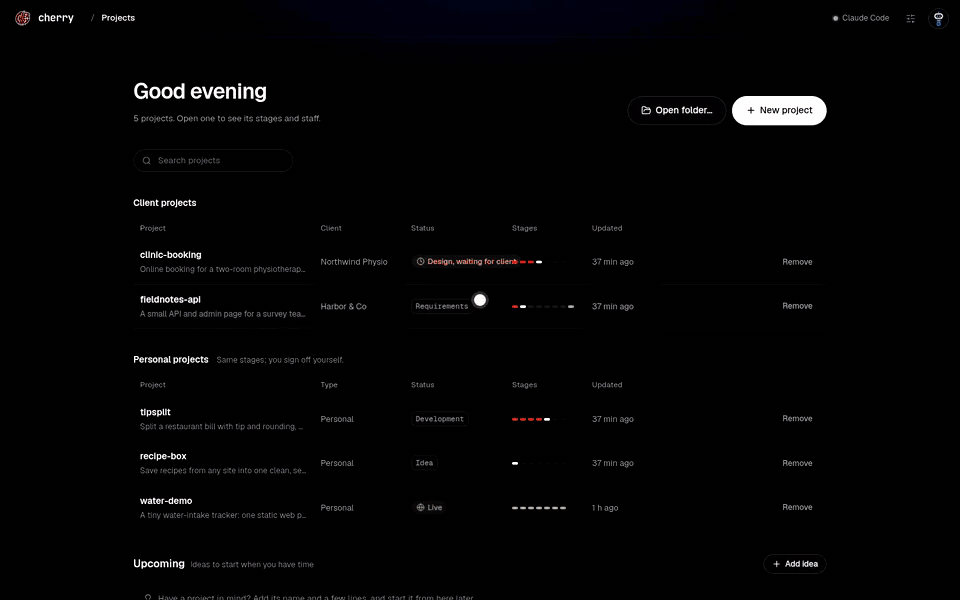
</p>

Cherry is a local workspace that runs your projects with [Claude Code](https://claude.com/claude-code)
the way a small software company works: **seven stages from Idea to Deployment, a staff agent in
each, and a crew of specialists that checks the work.** A stage opens only when you sign off the
one before it. Cherry runs on your own computer at `127.0.0.1`, works on the project folders you
open in it, and nothing runs until you give a job.

It is not a code editor and not a vibe-coding tool. You read code and docs here, you make the
decisions here, and Claude does the typing, only after you say yes.

## Who it is for

- **Freelancers and small studios:** client sign-offs with names and dates, questions for the
  client, change requests, PDF documents, time, costs and an invoice.
- **Solo builders:** the same stages on your own ideas, signed off by you. Plans and decisions
  stay in the repo, so a project you left for a month says where it stands.
- **People learning the craft:** an SRS, ADRs, a test plan and a release runbook, each written
  by an agent in the role that writes it, next to the code.
- **Claude Code users who want control:** approval cards, every model call on your click, and a
  token budget per project.

## Contents

- [Who it is for](#who-it-is-for)
- [Features](#features)
- [How it works](#how-it-works)
- [Install](#install)
- [Usage](#usage)
- [Safety and privacy](#safety-and-privacy)
- [Token use](#token-use)
- [Claude Code skill](#claude-code-skill)
- [Development](#development)
- [Contributing](#contributing)
- [Credits and licence](#credits-and-licence)

## Features

<table>
  <tr>
    <td width="50%" valign="top">
      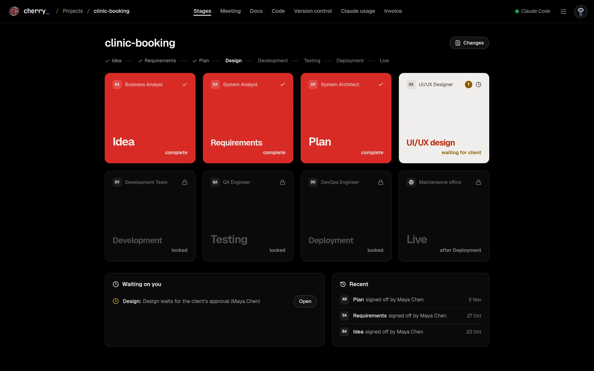<br />
      <b>Seven stages, signed off.</b> Idea to Deployment, a staff agent in each. A stage opens
      when the one before it is signed off, by your client or by you.
    </td>
    <td width="50%" valign="top">
      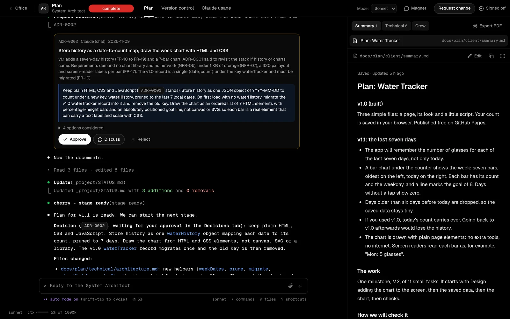<br />
      <b>Plan before code.</b> Each agent asks one question at a time on a card, with a
      recommended option, and every real choice becomes an ADR you approve.
    </td>
  </tr>
  <tr>
    <td width="50%" valign="top">
      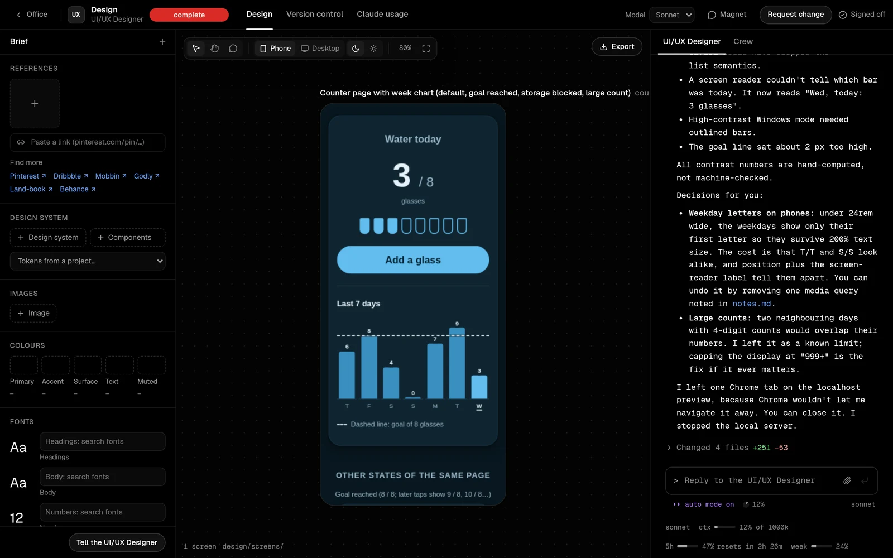<br />
      <b>Screens before code.</b> Real HTML screens on a canvas, phone and desktop, light and
      dark. Sign-off writes the handoff for Development.
    </td>
    <td width="50%" valign="top">
      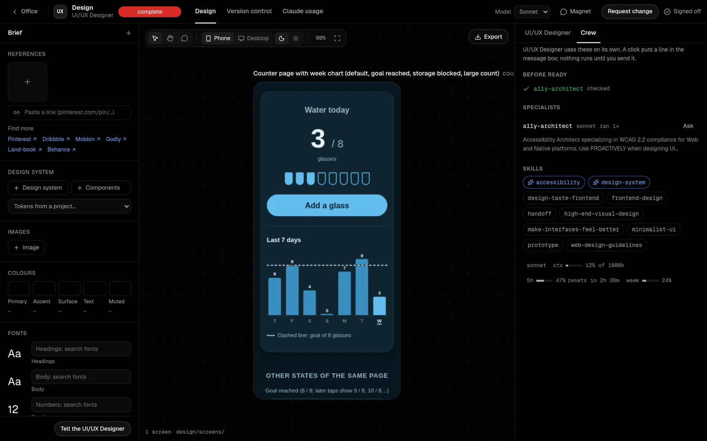<br />
      <b>A crew in every room.</b> Specialists check the work: accessibility in Design, a code
      review in Development, a security review in Testing. A stage is not ready until they ran.
    </td>
  </tr>
  <tr>
    <td width="50%" valign="top">
      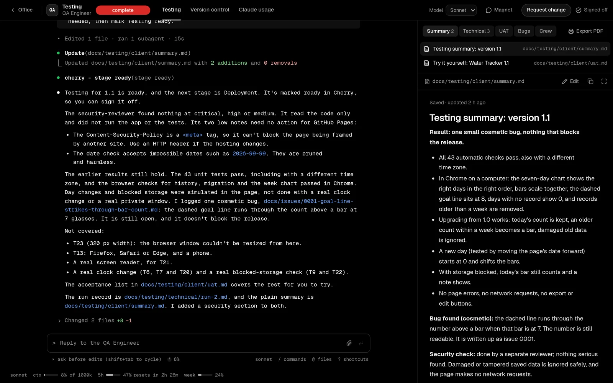<br />
      <b>Tested before release.</b> QA runs the plan in the browser, logs bugs as issues and
      writes a plain summary with an acceptance list. Client documents export as a PDF.
    </td>
    <td width="50%" valign="top">
      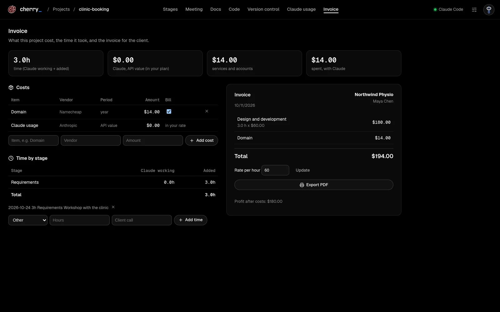<br />
      <b>Run it like a business.</b> Claude usage per stage, a token budget, time and costs,
      and the invoice at your rate.
    </td>
  </tr>
</table>

**Also in the box**

| | |
| --- | --- |
| **Projects** | Client projects and personal projects, each with its stage and a small track of the seven stages. **New project** picks client or personal. **Open folder…** adds a folder from anywhere; **Set up office** brings an existing project into the stages. |
| **The office** | Seven stages in order, each with a staff agent: Idea (Business Analyst), Requirements (System Analyst), Plan (System Architect), Design (UI/UX Designer), Development (Development Team), Testing (QA Engineer), Deployment (DevOps Engineer). A stage opens when the one before it is signed off, with the client's approval or yours on a personal project. Nothing runs until you give a job. |
| **The crew** | Every room has its own skills and specialist agents, shown in a **Crew** tab. After each message Cherry names the skills and specialists that fit the job (plain word matching, no model call). Design, Development and Testing have required checks: `stage_ready` refuses until the specialist ran, so every release gets an accessibility, code and security check. |
| **Scan agents** | Security review, test runner, code health and dependency audit: read-only, one click, a report you read in the centre. |
| **Stage rooms** | The agent's chat in the Claude Code look, its client and technical documents, Sign off, and Request change. Requirements has the questions for the client, Development the prototype gate, Testing the acceptance test and bugs. Client documents export as a PDF. |
| **Project tabs** | **Meeting** (every agent's work, an agenda, action items), **Docs** (a vault of the documents with links, backlinks and a graph), **Code** (an editor like VS Code), **Version control**, **Claude usage** (limits and the project's token budget) and **Invoice** (time, costs and the invoice at your rate). |
| **Live and maintenance** | Signing off Deployment makes the project Live: support requests, bugs, QA, fixes and upgrades, and **New version** starts v2.0 next to the live v1.0. **Magnet** is the project manager you ask about progress and costs. |
| **Calibration** | For an existing project: a read-only scan, a few questions, and docs you tick file by file. Existing files only get additions. |
| **Quiet by default** | A right rail (Overview, Live, GitHub, Chat) that stays closed until you open it, a status bar, and a command palette (`Ctrl K`) for every other view: Docs, Notes and tasks, Agents, Decisions, Status report. |
| **Chat** | One chat in the Claude Code CLI look for every stage: `>` and `●` lines, tool calls as `Update(src/app.ts)`, folded steps, the turning-star spinner, numbered permission prompts (1, 2, 3, Esc), Shift+Tab for the mode, slash commands, @ files, compact, history, rewind, attachments. |
| **Background agents** | A task runs on its own git worktree and branch while you keep chatting. It works without asking; push and publish are left for you. Review the diff, then Merge or Discard; on a conflict, an agent can fix it. |
| **Git and GitHub** | Branch, ahead and behind, pull, push after approval, open pull requests, and commits as yourself: stage and commit like in VS Code, or turn on Auto commit and Claude commits its work in small steps. |
| **Themes** | Just black (default), Cherry dark, Cherry light and Classic. |
| **First start** | A short welcome: pick where new projects go, check Claude Code, git and GitHub, choose a theme. |

<details>
<summary><b>More screenshots</b></summary>
<br />

| Projects | Requirements |
| --- | --- |
| 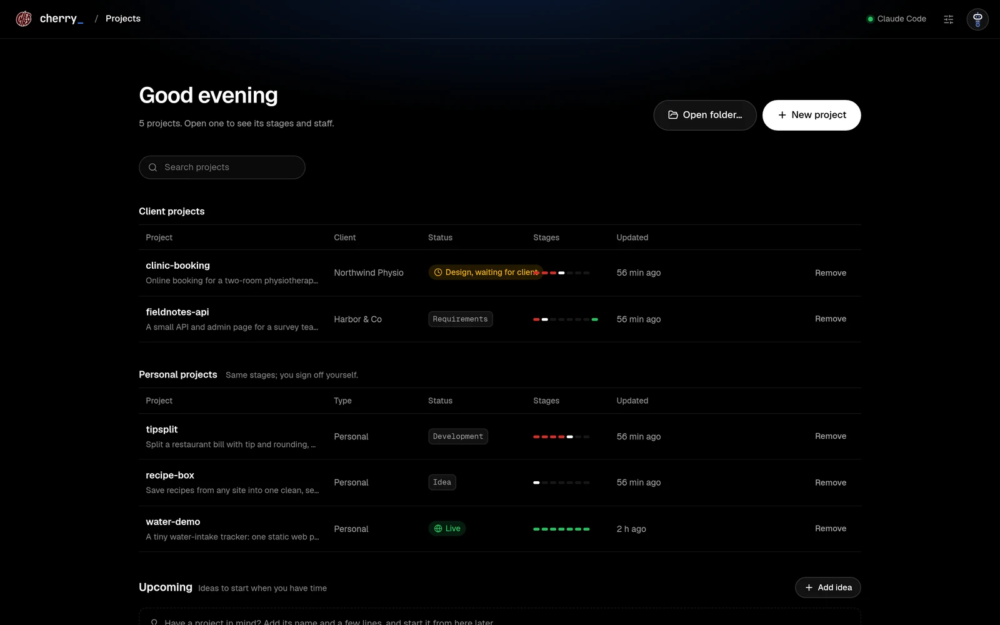 | 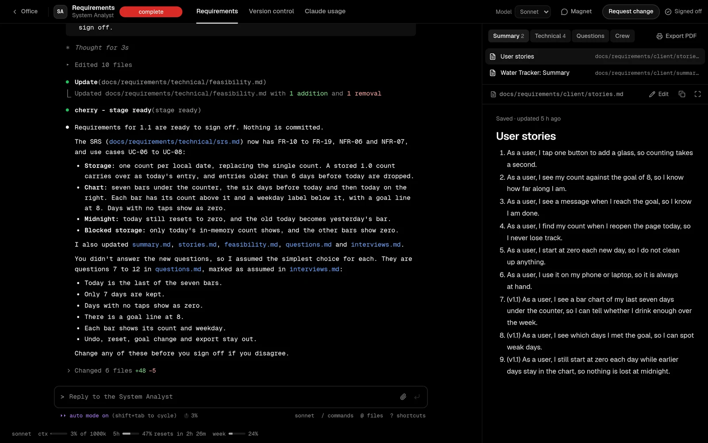 |
| **Development: the prototype gate** | **Code** |
| 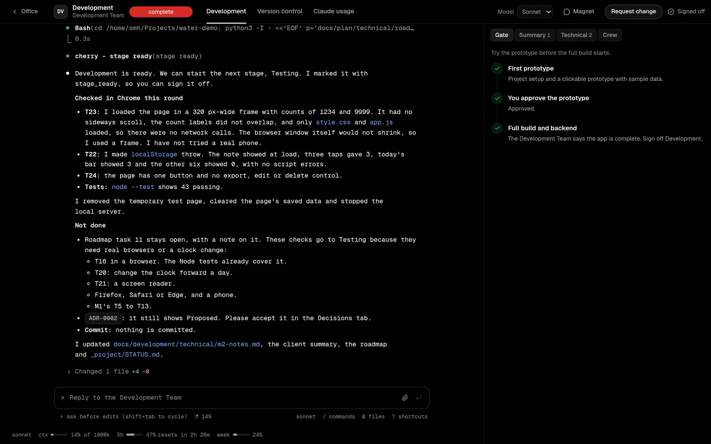 | 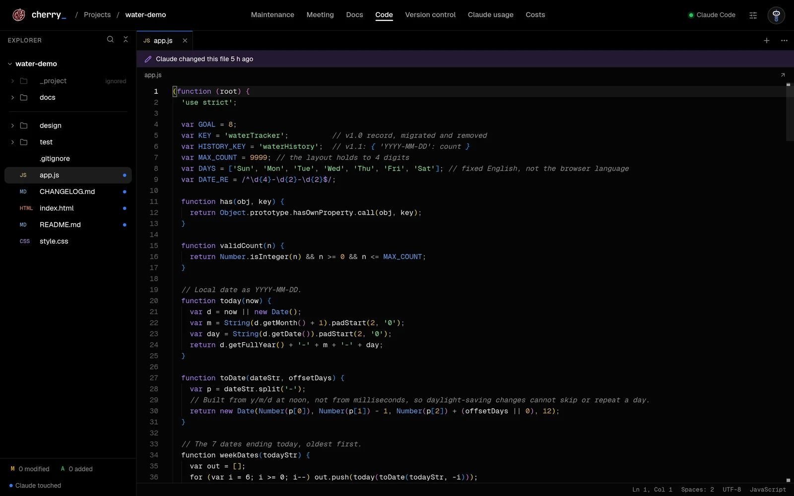 |
| **Docs vault** | **Claude usage** |
| 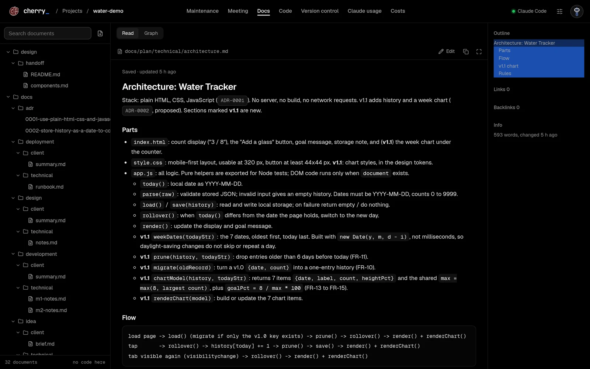 | 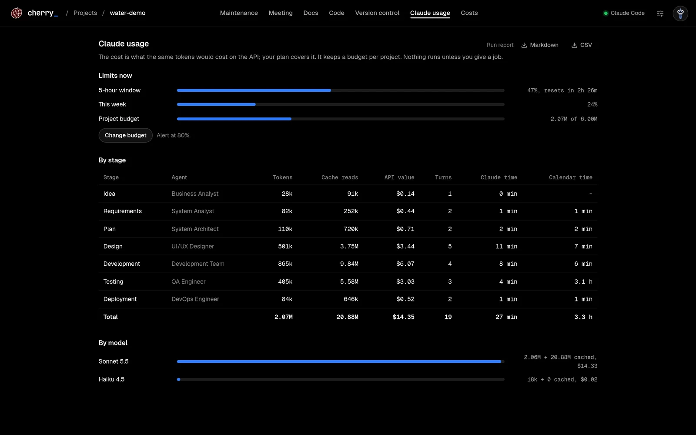 |
| **Meeting** | **Version control** |
| 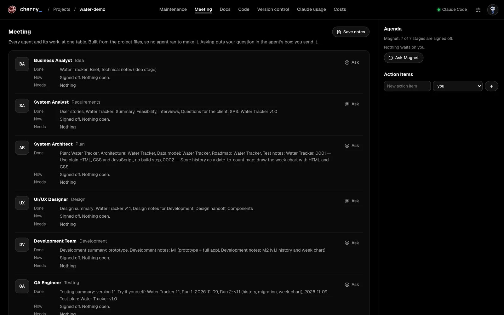 | 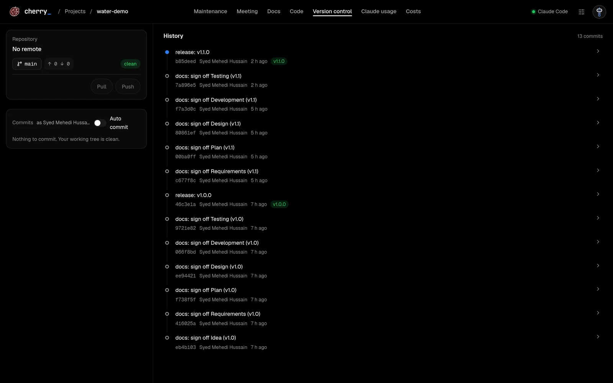 |
| **Maintenance office** | **Client document as PDF** |
| 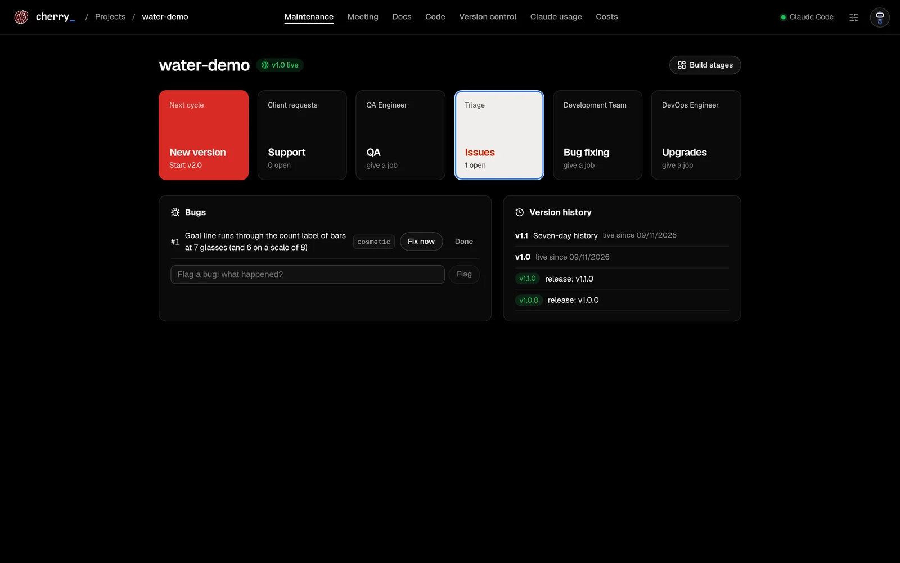 | 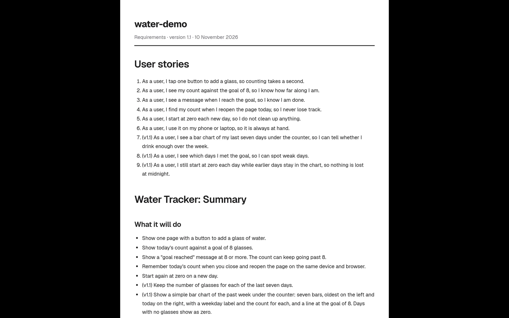 |

</details>

## How it works

1. **Idea and Requirements.** Describe the idea. The Business Analyst and the System Analyst
   ask short questions, each with a recommended option, and write the brief and the SRS.
2. **Plan and Design.** The System Architect writes the architecture, data model and roadmap;
   every real choice becomes an ADR. The Designer draws the screens and an accessibility
   specialist checks them.
3. **Development and Testing.** The Development Team builds a prototype for your approval, then
   the rest, test first, with a code review. QA tests it and a security review runs.
4. **Deployment and Live.** The DevOps Engineer releases it. **New version** starts the next
   cycle next to the live one.

You sign off each stage (or your client does). Nothing starts without a job from you.

Under the hood, the `cherry` command starts a small daemon (Fastify, SQLite cache) on
`127.0.0.1:4317`. It drives your local `claude` CLI through the Claude Agent SDK and serves a
React UI. Project state lives in each project's `_project/` folder, kept out of git.

## Install

**Requirements**

- Linux. macOS and Windows are not supported yet.
- [Claude Code](https://claude.com/claude-code), signed in (`claude auth login`).
- git. The [GitHub CLI](https://cli.github.com) `gh` is optional (GitHub box, Push, new repos).
- [mise](https://mise.jdx.dev), or Node 22 and pnpm on your own.

```bash
git clone https://github.com/syedmehedihussain/cherry.git
cd cherry
mise install               # Node 22 + pnpm from mise.toml
pnpm install
./scripts/install-cli.sh   # puts `cherry` in ~/.local/bin
cherry start               # always on: runs in the background, starts at login
```

`cherry start` sets Cherry up as a background service that starts every time you log in, then
opens a one-time login link. Bookmark http://127.0.0.1:4317 after that: you stay logged in as
long as you use Cherry at least once in 30 days. Prefer to start it by hand? Run `cherry`
instead of `cherry start`. On first start, Cherry asks where new
projects should go (default `~/Projects`), checks your tools and lets you pick a theme. Then open
a project folder (**Open folder…** or `cherry .` in it) or start a new one.

**Update:** `git pull && pnpm install && cherry restart` (the UI is rebuilt when it changed).

## Usage

| Command | Does |
| --- | --- |
| `cherry start` | Always on: run in the background and start at login (systemd user service) |
| `cherry stop` | Stop it and turn always-on off |
| `cherry restart` | Restart it, after an update |
| `cherry` | Start if needed and open the browser with a login link (`--no-open` only prints it) |
| `cherry down` / `cherry status` | Stop until the next `cherry` or login / show whether it runs |
| `cherry .` | Open this folder in Cherry, like `code .` (it joins Home next to your projects) |
| `cherry open <folder or project>` | Open a folder from anywhere, or a project by name |
| `cherry doctor` | Check Node, git, gh and Claude Code |
| `cherry logout` | End every browser session |

Keyboard: <kbd>Enter</kbd> sends, <kbd>Shift</kbd>+<kbd>Enter</kbd> adds a line,
<kbd>↑</kbd>/<kbd>↓</kbd> move between options on a decision card, <kbd>Ctrl</kbd>+<kbd>S</kbd>
saves in the editor, <kbd>Esc</kbd> closes Magnet or a dialog.

## Safety and privacy

- **Loopback only.** The daemon binds `127.0.0.1`. Every request needs a session from the
  one-time login link; Host and Origin are checked.
- **Nothing without a yes.** Claude never edits a file or runs a command in chat without your
  approval. `sudo`, force pushes to `main`, `curl | sh` and `rm -rf` outside the project are
  blocked outright.
- **Secrets stay secret.** `.env` files, keys and credentials are never read, and Claude's file
  tools cannot leave the project folder (symlinks are resolved).
- **No telemetry.** The only traffic is Claude Code's own, and git or gh when you pull, push or
  create a repo.

Details: [`docs/security.md`](docs/security.md). To report a vulnerability, see
[`SECURITY.md`](SECURITY.md).

## Token use

Cherry is built to be easy on your plan. **Every model call starts from your click**: there is
no autopilot, no background run and no automatic Haiku job
([ADR-0055](docs/adr/0055-every-model-call-starts-from-a-click.md)). Change summaries, job hints,
handoff notes and the Run button cost no tokens at all. Each project has a token budget, and the
Claude usage tab shows tokens and API value per stage. In a real run, a small feature (a history
and a week chart for a tiny web app) took all seven stages on Sonnet for about 1.5M tokens.

## Claude Code skill

The repo ships a skill, [`.claude/skills/cherry`](.claude/skills/cherry/SKILL.md), that teaches
Claude Code how to install, run, use and troubleshoot Cherry, and how to drive a running copy
through `scripts/api.sh`. Claude Code picks it up inside this repo. To have it everywhere:

```bash
mkdir -p ~/.claude/skills && cp -r .claude/skills/cherry ~/.claude/skills/
```

## Development

```bash
pnpm dev          # daemon (127.0.0.1:4317) + web (127.0.0.1:5173) with live reload
pnpm test         # unit tests (vitest)
pnpm test:e2e     # browser tests (playwright, uses /usr/bin/chromium)
pnpm lint && pnpm typecheck
```

```
packages/cli      the `cherry` command
packages/daemon   Fastify + WebSockets, SQLite cache, Claude Agent SDK runner
packages/web      React 19 + Vite UI, plain CSS with design tokens
packages/shared   zod schemas shared by daemon and web
docs/             product, engineering and design docs, ADRs
site/             the landing page (GitHub Pages)
scripts/media/    the demo used for screenshots and the video
```

`pnpm dev` pauses the always-on Cherry while it runs (same port and `~/.cherry`) and starts it
again when you quit. Start with [`CLAUDE.md`](CLAUDE.md), then
[`docs/README.md`](docs/README.md) (a map of every document) and
[`docs/roadmap.md`](docs/roadmap.md).

## Contributing

Issues and pull requests are welcome. Read [`CONTRIBUTING.md`](CONTRIBUTING.md) first: it
covers the setup, the checks to run and how decisions are recorded.

## Credits and licence

Cherry is a side quest of **smh**, designed and built by Syed Mehedi Hussain.

[Website](https://syedmehedihussain.codes/) ·
[GitHub](https://github.com/syedmehedihussain) ·
[Email](mailto:syedmehedihussain@gmail.com)

Released under the [MIT licence](LICENSE). Cherry is an independent project and is not
affiliated with Anthropic. Claude and Claude Code are trademarks of Anthropic.
