<p align="center">
  <picture>
    <source media="(prefers-color-scheme: dark)" srcset="docs/design/brand/lockup-dark.svg" />
    
  </picture>
</p>

<p align="center"><b>Claude Code, with a plan.</b><br /><code>$ cherry-pick your workflow</code></p>

<p align="center">
  <a href="https://github.com/syedmehedihussain/cherry/releases/latest"></a>
  <a href="https://github.com/syedmehedihussain/cherry/actions/workflows/ci.yml"></a>
  <a href="LICENSE"></a>
  
  <a href="https://claude.com/claude-code"></a>
</p>

<p align="center">
  <a href="https://syedmehedihussain.github.io/cherry/"><b>Website</b></a> ·
  <a href="#install">Install</a> ·
  <a href="#features">Features</a> ·
  <a href="docs/README.md">Docs</a> ·
  <a href="CHANGELOG.md">Changelog</a>
</p>

<p align="center">
  
</p>

Cherry is a local workspace that drives [Claude Code](https://claude.com/claude-code) the way
a senior engineer works: **survey, decide, document, then build.** It runs on your own computer
at `127.0.0.1`, reads your projects folder, and every edit and command waits for your approval.

It is not a code editor and not a vibe-coding tool. You read code and docs here, you make the
decisions here, and Claude does the typing, only after you say yes.

## Contents

- [Features](#features)
- [How it works](#how-it-works)
- [Install](#install)
- [Usage](#usage)
- [Safety and privacy](#safety-and-privacy)
- [Token use](#token-use)
- [Claude Code skill](#claude-code-skill)
- [Development](#development)
- [Contributing](#contributing)
- [Credits and licence](#credits-and-licence)

## Features

<table>
  <tr>
    <td width="50%" valign="top">
      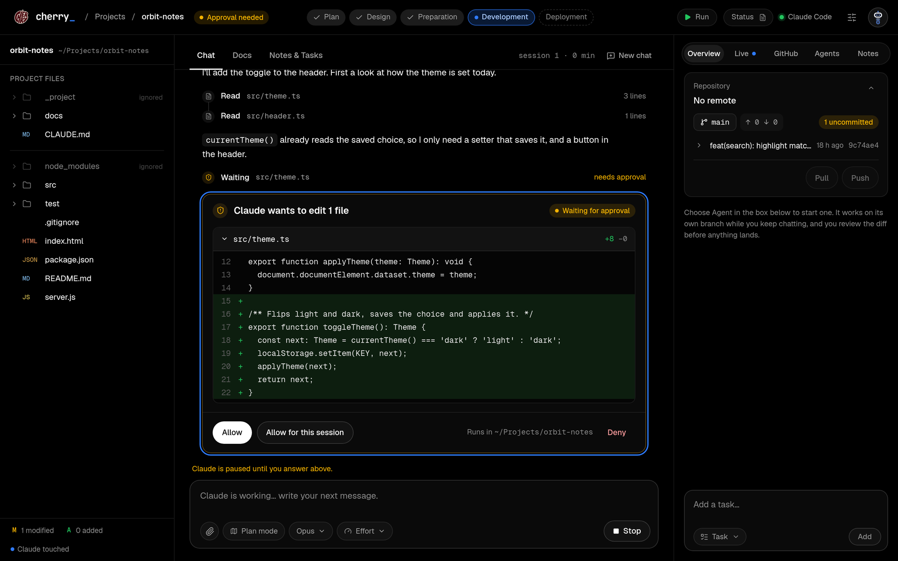<br />
      <b>Approve every change.</b> Edits arrive as diff cards, commands show what runs and where.
      Allow once, allow for the session, or deny with a reason.
    </td>
    <td width="50%" valign="top">
      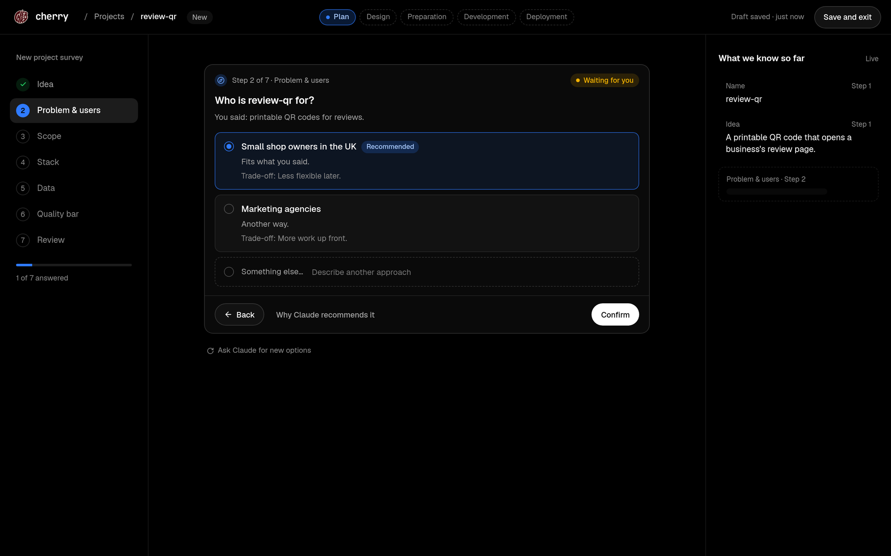<br />
      <b>Survey before code.</b> Seven decision cards (users, scope, stack, data, quality bar),
      then Claude writes CLAUDE.md, a PRD, ADRs, the architecture and the first commit.
    </td>
  </tr>
  <tr>
    <td width="50%" valign="top">
      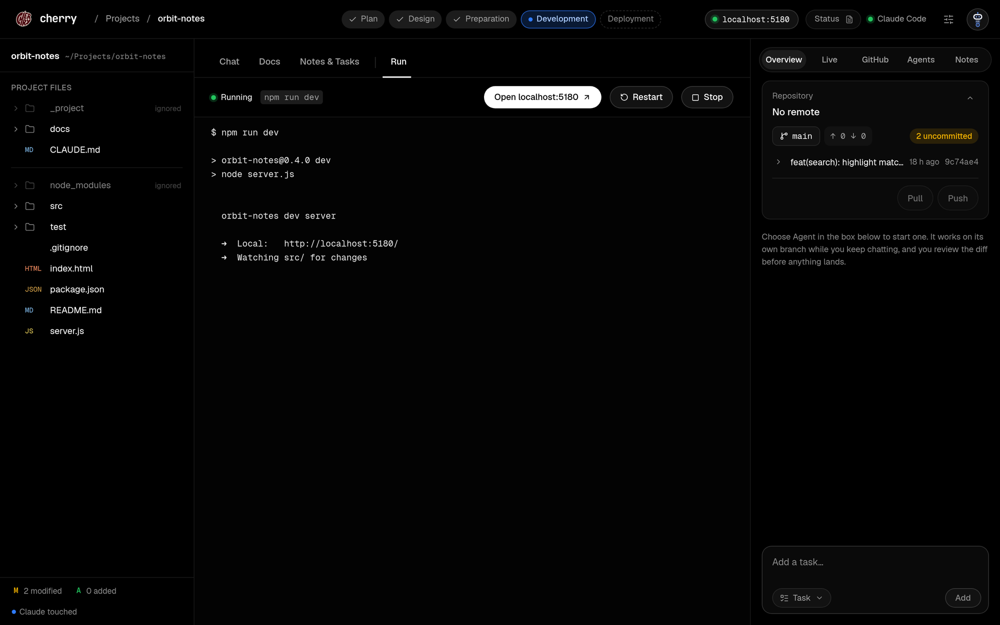<br />
      <b>Run it on localhost.</b> One play button starts the website's dev server, streams the
      output and gives you the link. It also finds servers Claude already started.
    </td>
    <td width="50%" valign="top">
      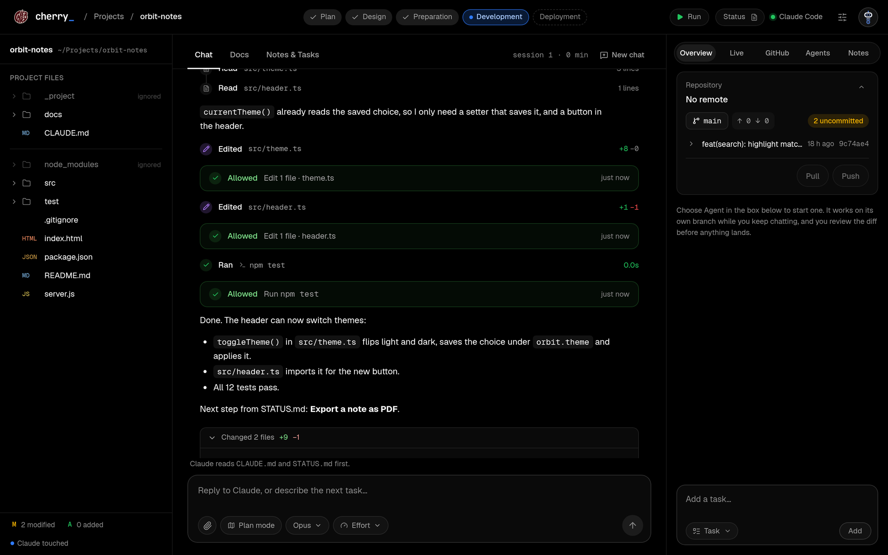<br />
      <b>See what changed.</b> After each reply: the files, the lines, the commands and how they
      went, for free. A plain-words explanation only when you click.
    </td>
  </tr>
  <tr>
    <td width="50%" valign="top">
      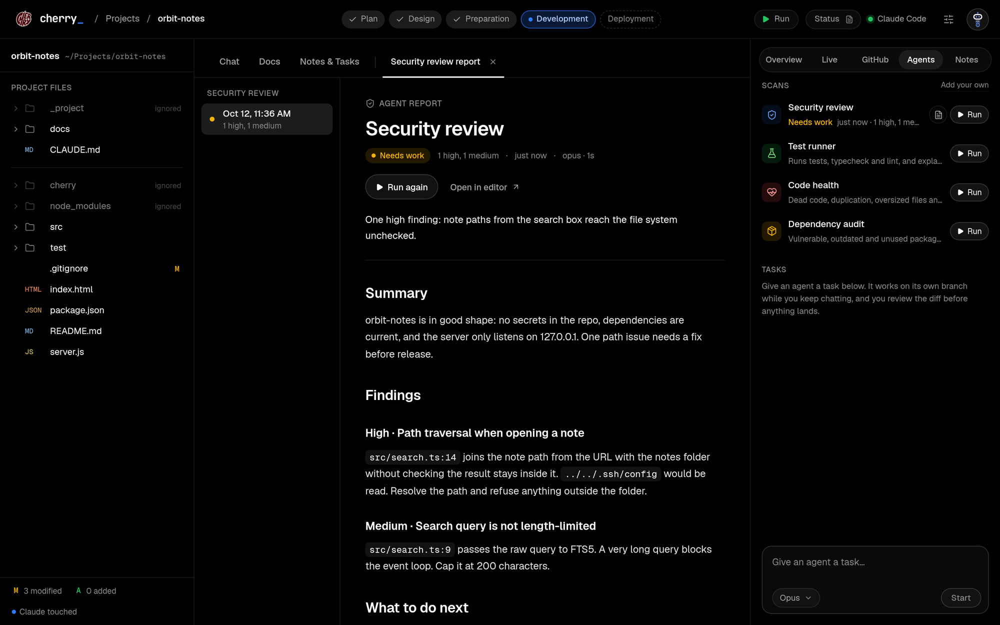<br />
      <b>Scan agents.</b> Security review, test runner, code health and dependency audit:
      read-only, one click, a report you read in the centre.
    </td>
    <td width="50%" valign="top">
      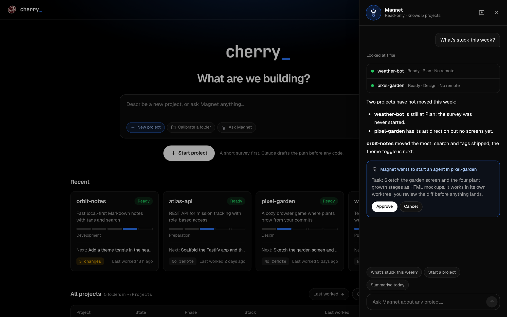<br />
      <b>Magnet.</b> An assistant across all your projects. Ask what is stuck; it answers and
      proposes actions you approve.
    </td>
  </tr>
</table>

**Also in the box**

| | |
| --- | --- |
| **Home** | Every project in your projects folder with its phase, git state and next step. |
| **Calibration** | For an existing project: a read-only scan, a few questions, and docs you tick file by file. Existing files only get additions. |
| **Workspace** | File tree with git letters, file viewer with diffs, Markdown preview, a built-in editor, Docs reader with ADR links, Notes & Tasks and a live Status report. |
| **Chat** | Streaming, plan mode, model and effort pickers, attachments, decision cards, Stop and resume. |
| **Background agents** | A task runs on its own git worktree and branch while you keep chatting. It works without asking; push and publish are left for you. Review the diff, then Merge or Discard; on a conflict, an agent can fix it. |
| **Git and GitHub** | Branch, ahead and behind, pull, push after approval, open pull requests, and commits grouped by Haiku that you make as yourself. |
| **Themes** | Just black (default), Cherry dark, Cherry light and Classic. |
| **First start** | A short welcome: pick the projects folder, check Claude Code, git and GitHub, choose a theme. |

<details>
<summary><b>More screenshots</b></summary>
<br />

| Home | Status report |
| --- | --- |
| 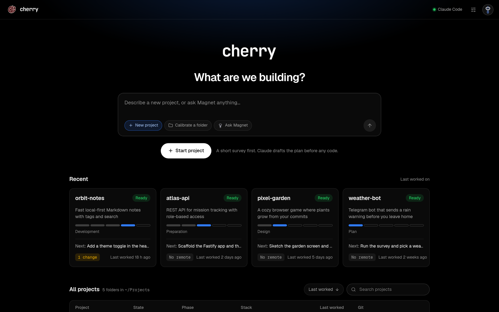 | 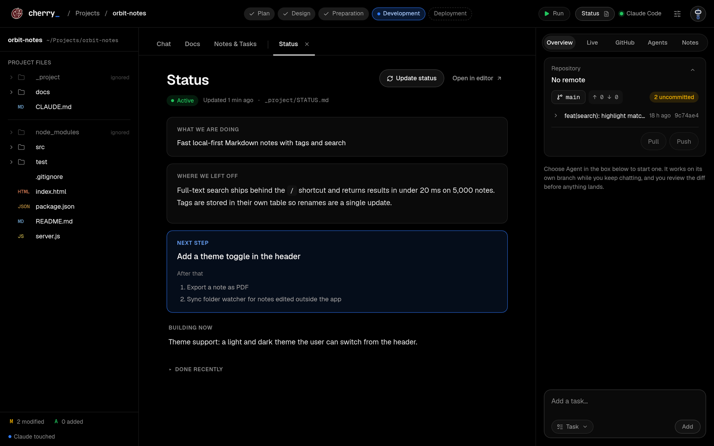 |
| **File viewer with changes** | **Markdown preview** |
| 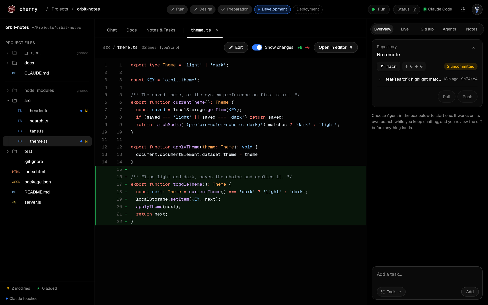 | 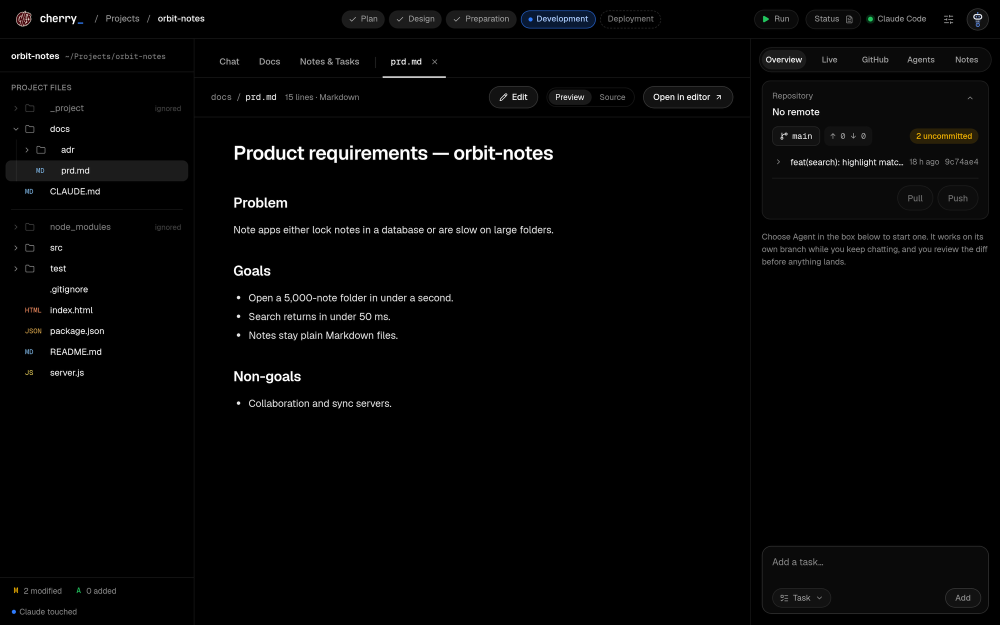 |
| **Themes** | **Welcome** |
| 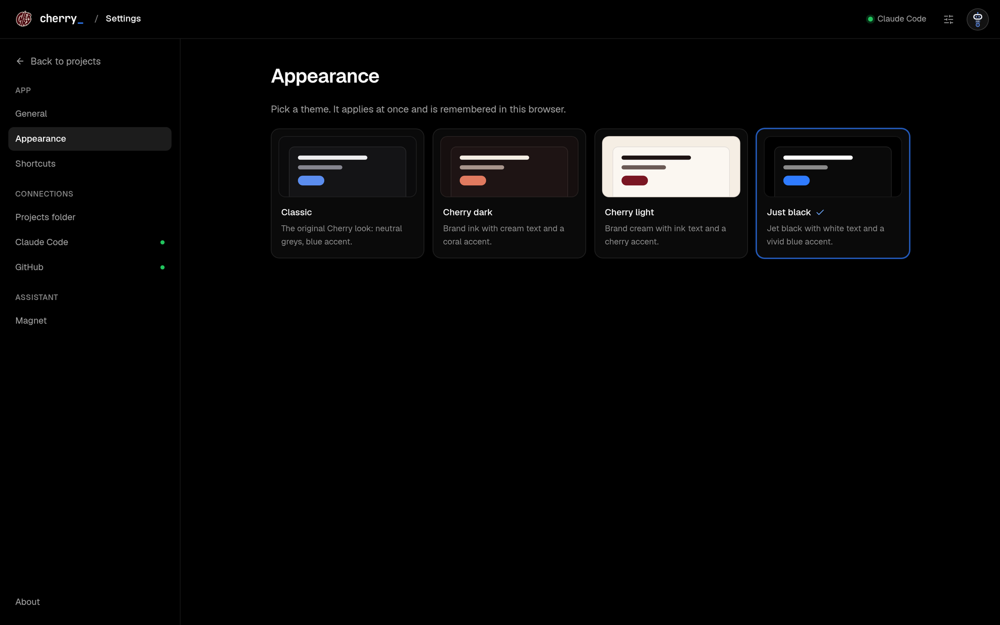 | 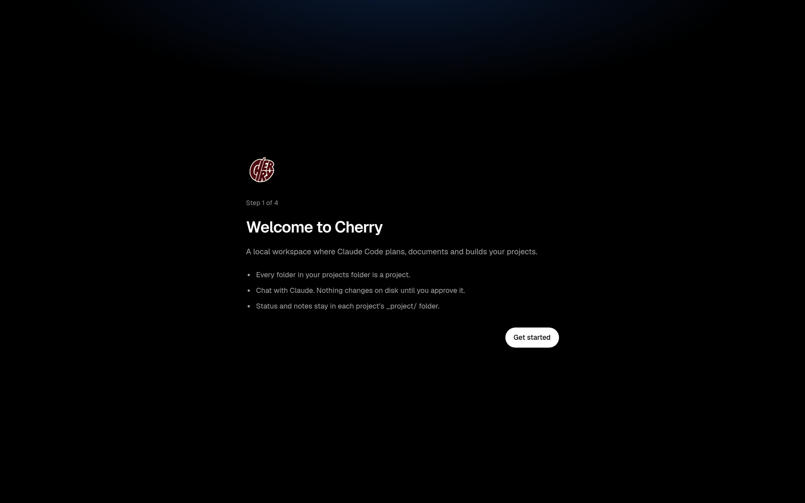 |

</details>

## How it works

1. **Survey.** Describe the idea and answer seven short questions. Each has a recommended option
   and its trade-off.
2. **Decide.** Every real choice becomes an ADR. Change an answer later and Cherry marks what
   needs a re-check.
3. **Document.** `CLAUDE.md`, the PRD, architecture, data model and `STATUS.md` are written
   before any code, with your approval.
4. **Build.** Chat, agents and scans do the work. You approve, run it, and commit in small steps.

Under the hood, the `cherry` command starts a small daemon (Fastify, SQLite cache) on
`127.0.0.1:4317`. It drives your local `claude` CLI through the Claude Agent SDK and serves a
React UI. Project state lives in each project's `_project/` folder, kept out of git.

## Install

**Requirements**

- Linux. macOS and Windows are not supported yet.
- [Claude Code](https://claude.com/claude-code), signed in (`claude auth login`).
- git. The [GitHub CLI](https://cli.github.com) `gh` is optional (GitHub box, Push, new repos).
- [mise](https://mise.jdx.dev), or Node 22 and pnpm on your own.

```bash
git clone https://github.com/syedmehedihussain/cherry.git
cd cherry
mise install               # Node 22 + pnpm from mise.toml
pnpm install
./scripts/install-cli.sh   # puts `cherry` in ~/.local/bin
cherry                     # starts Cherry and opens it in your browser
```

`cherry` prints a one-time login link and opens it. On first start, Cherry asks for your
projects folder (default `~/Projects`), checks your tools and lets you pick a theme.

**Update:** `git pull && pnpm install`, then `cherry down && cherry`.

## Usage

| Command | Does |
| --- | --- |
| `cherry` | Start and open the browser (`--no-open` only prints the link) |
| `cherry down` / `cherry status` | Stop / show whether it runs |
| `cherry open <project>` | Open a project's workspace |
| `cherry doctor` | Check Node, git, gh and Claude Code |
| `cherry logout` | End every browser session |
| `cherry install-service` | Start at login (systemd user service) |

Keyboard: <kbd>Enter</kbd> sends, <kbd>Shift</kbd>+<kbd>Enter</kbd> adds a line,
<kbd>↑</kbd>/<kbd>↓</kbd> move between options on a decision card, <kbd>Ctrl</kbd>+<kbd>S</kbd>
saves in the editor, <kbd>Esc</kbd> closes Magnet or a dialog.

## Safety and privacy

- **Loopback only.** The daemon binds `127.0.0.1`. Every request needs a session from the
  one-time login link; Host and Origin are checked.
- **Nothing without a yes.** Claude never edits a file or runs a command in chat without your
  approval. `sudo`, force pushes to `main`, `curl | sh` and `rm -rf` outside the project are
  blocked outright.
- **Secrets stay secret.** `.env` files, keys and credentials are never read, and Claude's file
  tools cannot leave the project folder (symlinks are resolved).
- **No telemetry.** The only traffic is Claude Code's own, and git or gh when you pull, push or
  create a repo.

Details: [`docs/security.md`](docs/security.md). To report a vulnerability, see
[`SECURITY.md`](SECURITY.md).

## Token use

Cherry is built to be easy on your plan. Small automatic jobs (tidying a note, grouping
commits, drafting a `.gitignore`) run on Haiku with capped prompts. Big jobs (reviews, scans,
reports, explanations) run only when you click. Change summaries and the Run button cost no
tokens at all. See [ADR-0022](docs/adr/0022-change-summary-and-click-only-claude.md).

## Claude Code skill

The repo ships a skill, [`.claude/skills/cherry`](.claude/skills/cherry/SKILL.md), that teaches
Claude Code how to install, run, use and troubleshoot Cherry, and how to drive a running copy
through `scripts/api.sh`. Claude Code picks it up inside this repo. To have it everywhere:

```bash
mkdir -p ~/.claude/skills && cp -r .claude/skills/cherry ~/.claude/skills/
```

## Development

```bash
pnpm dev          # daemon (127.0.0.1:4317) + web (127.0.0.1:5173) with live reload
pnpm test         # unit tests (vitest)
pnpm test:e2e     # browser tests (playwright, uses /usr/bin/chromium)
pnpm lint && pnpm typecheck
```

```
packages/cli      the `cherry` command
packages/daemon   Fastify + WebSockets, SQLite cache, Claude Agent SDK runner
packages/web      React 19 + Vite UI, plain CSS with design tokens
packages/shared   zod schemas shared by daemon and web
docs/             product, engineering and design docs, ADRs
site/             the landing page (GitHub Pages)
scripts/media/    the demo used for screenshots and the video
```

`pnpm dev` and `cherry` cannot run at the same time. Start with [`CLAUDE.md`](CLAUDE.md), then
[`docs/README.md`](docs/README.md) (a map of every document) and
[`docs/roadmap.md`](docs/roadmap.md).

## Contributing

Issues and pull requests are welcome. Read [`CONTRIBUTING.md`](CONTRIBUTING.md) first: it
covers the setup, the checks to run and how decisions are recorded.

## Credits and licence

Cherry is a side quest of **smh**, designed and built by Syed Mehedi Hussain.

[Website](https://syedmehedihussain.codes/) ·
[GitHub](https://github.com/syedmehedihussain) ·
[Email](mailto:syedmehedihussain@gmail.com)

Released under the [MIT licence](LICENSE). Cherry is an independent project and is not
affiliated with Anthropic. Claude and Claude Code are trademarks of Anthropic.
